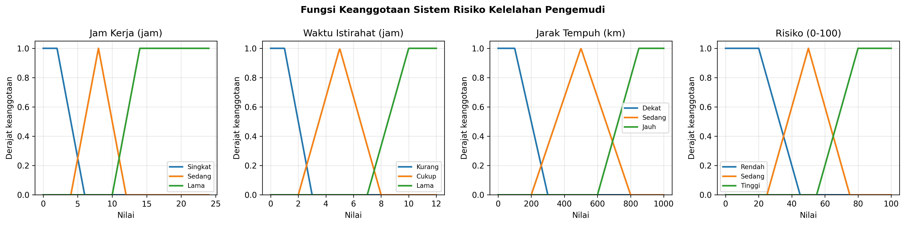
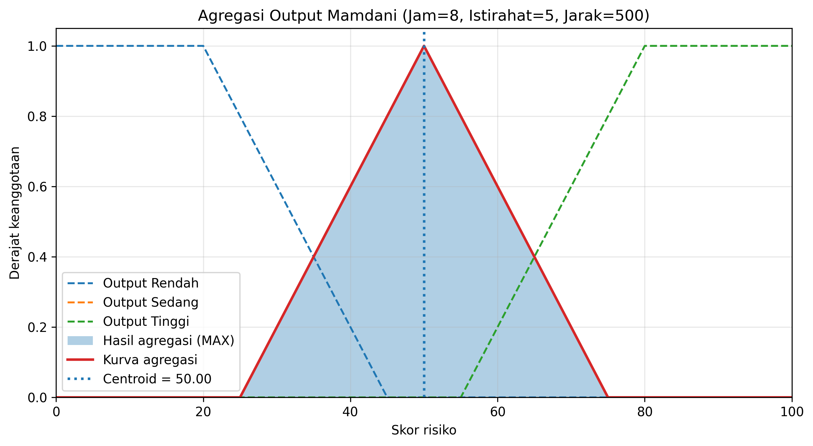
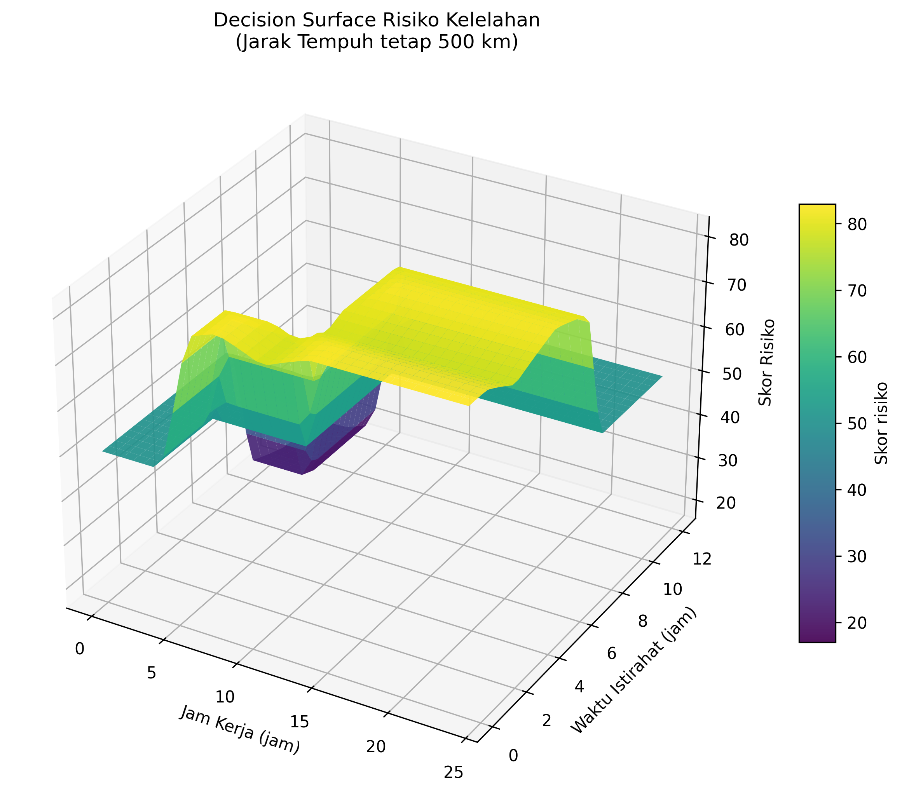

# LAPORAN ASESMEN MODUL 2

## FUZZY DECISION SYSTEM

### Penilaian Risiko Kelelahan Pengemudi

**Metode: Mamdani**

------------------------------------------------------------------------

# 1. Identitas & Judul Proyek

## 1.1 Identitas Mahasiswa

  Keterangan       Identitas
  ---------------- --------------------------------------------------
  Nama             ................................................
  NIM              ................................................
  Program Studi    ................................................
  Mata Kuliah      Logika Fuzzy
  Dosen Pengampu   ................................................
  Modul            Asesmen Modul 2 -- Fuzzy Decision System

## 1.2 Judul Proyek

**Penilaian Risiko Kelelahan Pengemudi Menggunakan Metode Fuzzy
Mamdani**

## 1.3 Latar Belakang

Kelelahan pengemudi merupakan salah satu faktor yang dapat memengaruhi
konsentrasi dan kemampuan seseorang ketika berkendara. Durasi kerja yang
panjang, waktu istirahat yang kurang, serta jarak tempuh yang jauh dapat
meningkatkan potensi kelelahan.

Penilaian risiko kelelahan tidak selalu mudah dilakukan hanya dengan
menggunakan batas angka yang kaku. Sebagai contoh, perbedaan beberapa
menit atau jam pada waktu kerja dan istirahat tidak selalu langsung
mengubah kondisi seseorang secara mutlak. Oleh karena itu, logika fuzzy
dapat digunakan untuk memetakan nilai input numerik ke dalam kategori
linguistik seperti *Singkat*, *Sedang*, *Lama*, *Kurang*, *Cukup*, dan
*Jauh*.

Pada proyek ini dikembangkan sistem keputusan fuzzy menggunakan metode
Mamdani. Sistem menerima tiga variabel input, yaitu jam kerja, waktu
istirahat, dan jarak tempuh. Hasil akhirnya berupa skor risiko pada
rentang 0 sampai 100 yang dikelompokkan menjadi kategori Rendah, Sedang,
atau Tinggi.

## 1.4 Tujuan Proyek

Tujuan dari proyek ini adalah:

1.  Menerapkan sistem inferensi fuzzy Mamdani untuk penilaian risiko
    kelelahan pengemudi.
2.  Menggunakan tiga variabel input dan satu variabel output.
3.  Membentuk basis aturan yang terdiri dari 27 aturan fuzzy.
4.  Mengimplementasikan proses fuzzifikasi, inferensi, agregasi, dan
    defuzzifikasi menggunakan Python.
5.  Menguji sistem menggunakan lima skenario data.
6.  Menampilkan grafik fungsi keanggotaan, agregasi output, dan
    *decision surface* tiga dimensi.

## 1.5 Batasan Sistem

Sistem ini merupakan prototipe akademik untuk mempelajari penerapan
logika fuzzy. Skor yang dihasilkan bukan diagnosis medis dan belum dapat
digunakan sebagai satu-satunya dasar untuk menentukan kelayakan
seseorang mengemudi. Parameter fungsi keanggotaan dan aturan merupakan
parameter rancangan model yang digunakan dalam tugas ini.

------------------------------------------------------------------------

# 2. Ringkasan Model Variabel Fuzzy (Review Modul 1)

Sistem menggunakan tiga variabel input dan satu variabel output.
Parameter fungsi keanggotaan dipertahankan sesuai model Modul 1.

## 2.1 Variabel Input

### A. Jam Kerja

Domain jam kerja adalah 0--24 jam. Variabel ini memiliki tiga himpunan
fuzzy.

  Himpunan   Jenis Fungsi   Parameter
  ---------- -------------- ------------------
  Singkat    Trapesium      (0, 0, 2, 6)
  Sedang     Segitiga       (4, 8, 12)
  Lama       Trapesium      (10, 14, 24, 24)

Interpretasi: - **Singkat:** durasi kerja berada pada rentang yang
relatif pendek. - **Sedang:** durasi kerja berada pada rentang
menengah. - **Lama:** durasi kerja berada pada rentang yang relatif
panjang.

### B. Waktu Istirahat

Domain waktu istirahat adalah 0--12 jam.

  Himpunan   Jenis Fungsi   Parameter
  ---------- -------------- -----------------
  Kurang     Trapesium      (0, 0, 1, 3)
  Cukup      Segitiga       (2, 5, 8)
  Lama       Trapesium      (7, 10, 12, 12)

Interpretasi: - **Kurang:** waktu istirahat relatif sedikit. -
**Cukup:** waktu istirahat berada pada rentang menengah. - **Lama:**
waktu istirahat relatif panjang.

### C. Jarak Tempuh

Domain jarak tempuh adalah 0--1000 km.

  Himpunan   Jenis Fungsi   Parameter
  ---------- -------------- ------------------------
  Dekat      Trapesium      (0, 0, 100, 300)
  Sedang     Segitiga       (200, 500, 800)
  Jauh       Trapesium      (600, 850, 1000, 1000)

Interpretasi: - **Dekat:** jarak tempuh relatif pendek. - **Sedang:**
jarak tempuh berada pada rentang menengah. - **Jauh:** jarak tempuh
relatif panjang.

## 2.2 Variabel Output

Variabel output adalah **Risiko Kelelahan**, dengan domain 0--100.

  Himpunan   Jenis Fungsi   Parameter
  ---------- -------------- --------------------
  Rendah     Trapesium      (0, 0, 20, 45)
  Sedang     Segitiga       (25, 50, 75)
  Tinggi     Trapesium      (55, 80, 100, 100)

Interpretasi: - **Rendah:** tingkat risiko berada pada kategori
rendah. - **Sedang:** tingkat risiko berada pada kategori menengah. -
**Tinggi:** tingkat risiko berada pada kategori tinggi.

## 2.3 Ringkasan Domain Variabel

  Variabel           Jenis          Domain   Jumlah Himpunan
  ------------------ -------- ------------ -----------------
  Jam kerja          Input       0--24 jam                 3
  Waktu istirahat    Input       0--12 jam                 3
  Jarak tempuh       Input      0--1000 km                 3
  Risiko kelelahan   Output         0--100                 3

## 2.4 Fungsi Keanggotaan

Fungsi keanggotaan digunakan untuk mengubah nilai tegas (*crisp*)
menjadi derajat keanggotaan fuzzy antara 0 dan 1.

Fungsi segitiga (*triangular membership function*) menggunakan tiga
parameter, yaitu (a), (b), dan (c).

\[ `\mu`{=tex}(x)=
```{=tex}
\begin{cases}
0, & x \leq a \text{ atau } x \geq c\\
\dfrac{x-a}{b-a}, & a < x < b\\
\dfrac{c-x}{c-b}, & b < x < c\\
1, & x=b
\end{cases}
```
\]

Fungsi trapesium (*trapezoidal membership function*) menggunakan empat
parameter, yaitu (a), (b), (c), dan (d).

\[ `\mu`{=tex}(x)=
```{=tex}
\begin{cases}
0, & x \leq a \text{ atau } x \geq d\\
\dfrac{x-a}{b-a}, & a < x < b\\
1, & b \leq x \leq c\\
\dfrac{d-x}{d-c}, & c < x < d
\end{cases}
```
\]

Pada implementasi program, fungsi trapesium juga menangani bentuk *left
shoulder* dan *right shoulder*. Bentuk tersebut digunakan ketika dua
parameter di sisi kiri atau kanan bernilai sama.

------------------------------------------------------------------------

# 3. Perancangan Basis Aturan (*Rule Base Matrix*)

## 3.1 Dasar Penyusunan Aturan

Basis aturan (*rule base*) digunakan untuk menghubungkan kondisi input
dengan keputusan output. Sistem memiliki tiga variabel input dan
masing-masing terdiri dari tiga himpunan fuzzy. Dengan demikian, jumlah
seluruh kombinasi aturan adalah:

\[ 3 `\times 3`{=tex} `\times 3`{=tex} = 27 `\text{ aturan}`{=tex} \]

Penyusunan aturan menggunakan prinsip rancangan berikut:

1.  Semakin lama jam kerja, skor tingkat risiko cenderung meningkat.
2.  Semakin lama waktu istirahat, skor tingkat risiko cenderung menurun.
3.  Semakin jauh jarak tempuh, skor tingkat risiko cenderung meningkat.

Untuk membentuk aturan secara sistematis, setiap label diberi skor
tingkat keparahan.

  Variabel    Label       Skor
  ----------- --------- ------
  Jam kerja   Singkat        0
  Jam kerja   Sedang         1
  Jam kerja   Lama           2
  Istirahat   Kurang         2
  Istirahat   Cukup          1
  Istirahat   Lama           0
  Jarak       Dekat          0
  Jarak       Sedang         1
  Jarak       Jauh           2

Jumlah skor ketiga variabel digunakan untuk menentukan konsekuen aturan:

-   Total skor ≤ 1 menghasilkan output **Rendah**.
-   Total skor 2--3 menghasilkan output **Sedang**.
-   Total skor lebih dari 3 menghasilkan output **Tinggi**.

Aturan tersebut merupakan mekanisme pembentukan basis aturan pada model
ini.

## 3.2 Matriks 27 Aturan Fuzzy

    No. Jam Kerja   Istirahat   Jarak Tempuh   Output Risiko
  ----- ----------- ----------- -------------- ---------------
    R01 Singkat     Kurang      Dekat          Sedang
    R02 Singkat     Kurang      Sedang         Sedang
    R03 Singkat     Kurang      Jauh           Tinggi
    R04 Singkat     Cukup       Dekat          Rendah
    R05 Singkat     Cukup       Sedang         Sedang
    R06 Singkat     Cukup       Jauh           Sedang
    R07 Singkat     Lama        Dekat          Rendah
    R08 Singkat     Lama        Sedang         Rendah
    R09 Singkat     Lama        Jauh           Sedang
    R10 Sedang      Kurang      Dekat          Sedang
    R11 Sedang      Kurang      Sedang         Tinggi
    R12 Sedang      Kurang      Jauh           Tinggi
    R13 Sedang      Cukup       Dekat          Sedang
    R14 Sedang      Cukup       Sedang         Sedang
    R15 Sedang      Cukup       Jauh           Tinggi
    R16 Sedang      Lama        Dekat          Rendah
    R17 Sedang      Lama        Sedang         Sedang
    R18 Sedang      Lama        Jauh           Sedang
    R19 Lama        Kurang      Dekat          Tinggi
    R20 Lama        Kurang      Sedang         Tinggi
    R21 Lama        Kurang      Jauh           Tinggi
    R22 Lama        Cukup       Dekat          Sedang
    R23 Lama        Cukup       Sedang         Tinggi
    R24 Lama        Cukup       Jauh           Tinggi
    R25 Lama        Lama        Dekat          Sedang
    R26 Lama        Lama        Sedang         Sedang
    R27 Lama        Lama        Jauh           Tinggi

## 3.3 Contoh Pembacaan Aturan

Contoh aturan R19:

**IF** Jam Kerja Lama **AND** Istirahat Kurang **AND** Jarak Dekat
**THEN** Risiko Tinggi.

Artinya, ketika durasi kerja termasuk kategori Lama, waktu istirahat
termasuk kategori Kurang, dan jarak tempuh termasuk kategori Dekat, maka
aturan tersebut memberikan kontribusi terhadap himpunan output Risiko
Tinggi.

Contoh aturan R07:

**IF** Jam Kerja Singkat **AND** Istirahat Lama **AND** Jarak Dekat
**THEN** Risiko Rendah.

Artinya, kondisi jam kerja singkat, waktu istirahat lama, dan jarak
tempuh dekat memberikan kontribusi terhadap himpunan output Risiko
Rendah.

------------------------------------------------------------------------

# 4. Metode Inferensi & Justifikasi Pemilihan

## 4.1 Metode yang Digunakan

Metode yang digunakan adalah **Fuzzy Inference System (FIS) Mamdani**.
Metode ini memproses input tegas menjadi keputusan fuzzy melalui
beberapa tahapan, yaitu fuzzifikasi, evaluasi aturan, implikasi,
agregasi, dan defuzzifikasi.

Konfigurasi operator pada sistem adalah:

  Tahapan           Metode
  ----------------- ----------
  AND               MIN
  Implication       MIN
  Aggregation       MAX
  Defuzzification   Centroid

## 4.2 Tahapan Proses Inferensi

### A. Fuzzifikasi

Fuzzifikasi mengubah nilai input numerik menjadi derajat keanggotaan
pada masing-masing himpunan fuzzy.

Contoh input: - Jam kerja = 8 jam. - Waktu istirahat = 5 jam. - Jarak
tempuh = 500 km.

Program menghitung derajat keanggotaan nilai tersebut terhadap himpunan
yang tersedia. Satu nilai dapat memiliki derajat keanggotaan pada lebih
dari satu himpunan fuzzy.

### B. Evaluasi Aturan (*Rule Evaluation*)

Setiap aturan dihitung menggunakan operator AND berupa MIN.

Untuk aturan dengan tiga kondisi, kekuatan aktivasi aturan dihitung
dengan:

\[ `\alpha`{=tex}*i =
`\min`{=tex}(`\mu`{=tex}*{`\text{jam}`{=tex}},`\mu`{=tex}*{`\text{istirahat}`{=tex}},`\mu`{=tex}*{`\text{jarak}`{=tex}})
\]

Nilai (`\alpha`{=tex}\_i) menunjukkan tingkat aktivasi aturan ke-i.
Aturan hanya diproses lebih lanjut jika nilai aktivasi lebih besar dari
nol.

### C. Implikasi (*Implication*)

Implikasi menggunakan operator MIN. Derajat aktivasi aturan digunakan
untuk memotong fungsi keanggotaan output sesuai kekuatan aturan.

\[
`\mu`{=tex}\_i(y)=`\min`{=tex}(`\alpha`{=tex}*i,`\mu`{=tex}*{`\text{output}`{=tex}\_i}(y))
\]

### D. Agregasi (*Aggregation*)

Semua hasil implikasi digabungkan menggunakan operator MAX. Dengan
demikian, pada setiap titik domain output, nilai keanggotaan gabungan
diambil dari nilai maksimum seluruh hasil implikasi.

\[
`\mu`{=tex}\_{`\text{gabungan}`{=tex}}(y)=`\max`{=tex}\_i(`\mu`{=tex}\_i(y))
\]

### E. Defuzzifikasi (*Centroid*)

Tahap terakhir mengubah hasil fuzzy menjadi satu nilai tegas (*crisp
output*). Metode yang digunakan adalah centroid atau titik pusat luas.

\[ z\^\* = `\frac{\int y \cdot \mu_{\text{gabungan}}(y)\,dy}`{=tex}
{`\int `{=tex}`\mu`{=tex}\_{`\text{gabungan}`{=tex}}(y),dy} \]

Pada program, centroid dihitung secara diskret menggunakan array `Y`
yang terdiri dari 1001 titik pada rentang 0 sampai 100:

\[ z\^\* = `\frac{\sum_j y_j \mu_{\text{gabungan}}(y_j)}`{=tex}
{`\sum`{=tex}*j `\mu`{=tex}*{`\text{gabungan}`{=tex}}(y_j)} \]

Karena jarak antar-titik pada domain output seragam, faktor jarak
antar-titik saling menghapus pada pembilang dan penyebut.

## 4.3 Kategori Hasil

Setelah mendapatkan skor crisp, program mengelompokkan hasil ke dalam
kategori pelaporan:

                 Skor Risiko Kategori
  -------------------------- ----------
              Kurang dari 40 Rendah
    40 sampai kurang dari 70 Sedang
               70 sampai 100 Tinggi

## 4.4 Justifikasi Pemilihan Metode Mamdani

Metode Mamdani dipilih karena:

1.  **Mudah dipahami:** aturan dapat ditulis menggunakan bahasa IF-THEN
    yang mudah dijelaskan.
2.  **Mendukung variabel linguistik:** kondisi jam kerja, istirahat, dan
    jarak dapat direpresentasikan dalam label fuzzy.
3.  **Mudah divisualisasikan:** fungsi keanggotaan, hasil pemotongan,
    dan agregasi output dapat ditampilkan dalam bentuk grafik.
4.  **Menghasilkan keputusan tegas:** metode centroid menghasilkan satu
    skor numerik yang dapat digunakan untuk menentukan kategori risiko.
5.  **Sesuai untuk prototipe akademik:** proses perhitungan dapat
    dipisahkan menjadi tahapan yang jelas sehingga mudah dipelajari dan
    diuji.

------------------------------------------------------------------------

# 5. Implementasi Program Python (Full Code & Penjelasan)

## 5.1 Bahasa dan Library

Program dibuat menggunakan Python dengan dua library utama:

  -----------------------------------------------------------------------
  Library                             Fungsi
  ----------------------------------- -----------------------------------
  NumPy                               Mengolah array numerik dan
                                      menghitung fungsi keanggotaan serta
                                      centroid

  Matplotlib                          Membuat grafik fungsi keanggotaan,
                                      agregasi output, dan decision
                                      surface

  itertools.product                   Membentuk seluruh kombinasi aturan
                                      fuzzy
  -----------------------------------------------------------------------

Instalasi dependensi:

``` bash
pip install numpy matplotlib
```

Nama file program:

``` text
Asesmen2_Fuzzy_Risiko_Kelelahan.py
```

## 5.2 Penjelasan Struktur Program

Program dibagi menjadi beberapa bagian:

1.  Fungsi `trimf()` dan `trapmf()` untuk menghitung fungsi keanggotaan
    segitiga dan trapesium.
2.  Variabel `INPUTS`, `DOMAIN`, `Y`, dan `OUTPUT_MF` untuk
    mendefinisikan domain serta himpunan fuzzy.
3.  Fungsi `consequent()` dan variabel `RULES` untuk membentuk 27
    aturan.
4.  Fungsi `validate_inputs()` dan `fuzzify()` untuk validasi dan
    fuzzifikasi input.
5.  Fungsi `infer()` sebagai mesin inferensi Mamdani dan defuzzifikasi
    centroid.
6.  Fungsi `risk_category()` dan `show_result()` untuk menampilkan hasil
    keputusan.
7.  Fungsi `print_rulebase()` untuk menampilkan seluruh aturan.
8.  Fungsi `test_scenarios()` untuk menguji lima skenario.
9.  Fungsi `plot_memberships()` untuk menampilkan kurva fungsi
    keanggotaan.
10. Fungsi `plot_aggregation_example()` untuk menampilkan hasil agregasi
    dan centroid.
11. Fungsi `plot_decision_surface()` untuk membuat grafik permukaan
    keputusan 3D.
12. Fungsi `manual_input()` dan `main()` untuk menerima input pengguna
    dan menjalankan menu utama.

## 5.3 Kode Program Lengkap

Simpan kode berikut dengan nama `Asesmen2_Fuzzy_Risiko_Kelelahan.py`.

``` python
"""
ASESMEN MODUL 2 — FUZZY DECISION SYSTEM
Penilaian Risiko Kelelahan Pengemudi
Metode: Mamdani

AND = MIN
Implication = MIN
Aggregation = MAX
Defuzzification = Centroid

Dependensi:
    pip install numpy matplotlib

Jalankan:
    python Asesmen2_Fuzzy_Risiko_Kelelahan.py
"""

import numpy as np
import matplotlib.pyplot as plt
from itertools import product


# ============================================================
# 1. FUNGSI KEANGGOTAAN FUZZY
# ============================================================

def trimf(x, a, b, c):
    """Fungsi keanggotaan segitiga."""
    x = np.asarray(x, dtype=float)
    y = np.zeros_like(x, dtype=float)

    if a == b:
        y = np.where(x <= b, 1.0, y)
    else:
        mask = (x > a) & (x < b)
        y = np.where(mask, (x - a) / (b - a), y)

    y = np.where(x == b, 1.0, y)

    if b == c:
        y = np.where(x >= b, 1.0, y)
    else:
        mask = (x > b) & (x < c)
        y = np.where(mask, (c - x) / (c - b), y)

    return np.clip(y, 0.0, 1.0)


def trapmf(x, a, b, c, d):
    """Fungsi keanggotaan trapesium, termasuk left/right shoulder."""
    x = np.asarray(x, dtype=float)
    y = np.zeros_like(x, dtype=float)

    # Bagian datar
    y = np.where((x >= b) & (x <= c), 1.0, y)

    # Sisi kiri
    if a == b:
        y = np.where(x <= b, 1.0, y)
    else:
        mask = (x > a) & (x < b)
        y = np.where(mask, (x - a) / (b - a), y)

    # Sisi kanan
    if c == d:
        y = np.where(x >= c, 1.0, y)
    else:
        mask = (x > c) & (x < d)
        y = np.where(mask, (d - x) / (d - c), y)

    return np.clip(y, 0.0, 1.0)


# ============================================================
# 2. DOMAIN DAN HIMPUNAN FUZZY
# Parameter dipertahankan sesuai model Modul 1/laporan.
# ============================================================

INPUTS = {
    "jam": {
        "Singkat": lambda x: trapmf(x, 0, 0, 2, 6),
        "Sedang": lambda x: trimf(x, 4, 8, 12),
        "Lama": lambda x: trapmf(x, 10, 14, 24, 24),
    },
    "istirahat": {
        "Kurang": lambda x: trapmf(x, 0, 0, 1, 3),
        "Cukup": lambda x: trimf(x, 2, 5, 8),
        "Lama": lambda x: trapmf(x, 7, 10, 12, 12),
    },
    "jarak": {
        "Dekat": lambda x: trapmf(x, 0, 0, 100, 300),
        "Sedang": lambda x: trimf(x, 200, 500, 800),
        "Jauh": lambda x: trapmf(x, 600, 850, 1000, 1000),
    },
}

DOMAIN = {
    "jam": (0, 24),
    "istirahat": (0, 12),
    "jarak": (0, 1000),
}

Y = np.linspace(0, 100, 1001)

OUTPUT_MF = {
    "Rendah": lambda y: trapmf(y, 0, 0, 20, 45),
    "Sedang": lambda y: trimf(y, 25, 50, 75),
    "Tinggi": lambda y: trapmf(y, 55, 80, 100, 100),
}


# ============================================================
# 3. BASIS ATURAN FUZZY (3 x 3 x 3 = 27 RULES)
# ============================================================

H_SEV = {"Singkat": 0, "Sedang": 1, "Lama": 2}
R_SEV = {"Kurang": 2, "Cukup": 1, "Lama": 0}
D_SEV = {"Dekat": 0, "Sedang": 1, "Jauh": 2}


def consequent(jam_label, rest_label, distance_label):
    score = (
        H_SEV[jam_label]
        + R_SEV[rest_label]
        + D_SEV[distance_label]
    )

    if score <= 1:
        return "Rendah"
    elif score <= 3:
        return "Sedang"

    return "Tinggi"


RULES = [
    (
        jam_label,
        rest_label,
        distance_label,
        consequent(jam_label, rest_label, distance_label)
    )
    for jam_label, rest_label, distance_label in product(
        INPUTS["jam"],
        INPUTS["istirahat"],
        INPUTS["jarak"]
    )
]


# ============================================================
# 4. FUZZIFIKASI DAN VALIDASI INPUT
# ============================================================

def validate_inputs(jam, istirahat, jarak):
    values = {
        "jam": jam,
        "istirahat": istirahat,
        "jarak": jarak
    }

    converted = {}

    for name, value in values.items():
        try:
            number = float(value)
        except (TypeError, ValueError):
            raise ValueError(f"Input {name} harus berupa angka.")

        minimum, maximum = DOMAIN[name]

        if not minimum <= number <= maximum:
            raise ValueError(
                f"Input {name} harus berada pada rentang "
                f"{minimum} sampai {maximum}."
            )

        converted[name] = number

    return (
        converted["jam"],
        converted["istirahat"],
        converted["jarak"]
    )


def fuzzify(value, fuzzy_sets):
    """Menghitung derajat keanggotaan setiap label linguistik."""
    return {
        label: float(np.asarray(function(np.array([value])))[0])
        for label, function in fuzzy_sets.items()
    }


# ============================================================
# 5. MESIN INFERENSI MAMDANI DAN DEFUZZIFIKASI CENTROID
# ============================================================

def infer(jam, istirahat, jarak):
    jam, istirahat, jarak = validate_inputs(
        jam, istirahat, jarak
    )

    # Tahap fuzzifikasi
    mu_jam = fuzzify(jam, INPUTS["jam"])
    mu_istirahat = fuzzify(istirahat, INPUTS["istirahat"])
    mu_jarak = fuzzify(jarak, INPUTS["jarak"])

    # AND menggunakan MIN
    # Implikasi menggunakan MIN
    # Agregasi menggunakan MAX
    aggregate = np.zeros_like(Y, dtype=float)
    active_rules = []

    for jam_label, rest_label, distance_label, output_label in RULES:

        alpha = min(
            mu_jam[jam_label],
            mu_istirahat[rest_label],
            mu_jarak[distance_label]
        )

        if alpha > 0:
            output_membership = OUTPUT_MF[output_label](Y)

            implied = np.minimum(
                alpha,
                output_membership
            )

            aggregate = np.maximum(
                aggregate,
                implied
            )

            active_rules.append({
                "jam": jam_label,
                "istirahat": rest_label,
                "jarak": distance_label,
                "output": output_label,
                "alpha": alpha,
            })

    # Defuzzifikasi menggunakan metode centroid
    denominator = np.sum(aggregate)

    if denominator <= 0:
        raise RuntimeError(
            "Tidak ada aturan aktif. Periksa cakupan fungsi keanggotaan."
        )

    crisp_output = float(
        np.sum(Y * aggregate) / denominator
    )

    return crisp_output, aggregate, active_rules


# ============================================================
# 6. KATEGORI HASIL DAN INFORMASI HASIL INFERENSI
# ============================================================

def risk_category(score):
    """Batas kategori pelaporan sesuai laporan proyek."""
    if score < 40:
        return "Rendah"
    elif score < 70:
        return "Sedang"

    return "Tinggi"


def show_result(jam, istirahat, jarak, show_rules=True):
    score, aggregate, active_rules = infer(
        jam, istirahat, jarak
    )

    print("\n========== HASIL KEPUTUSAN FUZZY MAMDANI ==========")
    print(f"Jam kerja       : {jam:.2f} jam")
    print(f"Waktu istirahat : {istirahat:.2f} jam")
    print(f"Jarak tempuh    : {jarak:.2f} km")
    print(f"Skor risiko     : {score:.2f} / 100")
    print(f"Kategori risiko : {risk_category(score)}")

    if show_rules:
        print("\nAturan yang aktif:")

        if not active_rules:
            print("Tidak ada aturan aktif.")
        else:
            for number, rule in enumerate(active_rules, start=1):
                print(
                    f"{number:02d}. IF Jam {rule['jam']} AND "
                    f"Istirahat {rule['istirahat']} AND "
                    f"Jarak {rule['jarak']} "
                    f"THEN Risiko {rule['output']} "
                    f"| alpha = {rule['alpha']:.3f}"
                )

    return score, aggregate, active_rules


# ============================================================
# 7. MENAMPILKAN SELURUH BASIS ATURAN
# ============================================================

def print_rulebase():
    print("\n================ BASIS ATURAN (27 RULES) ================")

    for number, (
        jam_label,
        rest_label,
        distance_label,
        output_label
    ) in enumerate(RULES, start=1):

        print(
            f"R{number:02d}: IF Jam {jam_label} AND "
            f"Istirahat {rest_label} AND Jarak {distance_label} "
            f"THEN Risiko {output_label}"
        )


# ============================================================
# 8. PENGUJIAN LIMA SKENARIO
# ============================================================

def test_scenarios():
    cases = [
        ("Normal/ringan", 3, 8, 100),
        ("Sedang", 6, 5, 250),
        ("Tengah", 8, 5, 500),
        ("Berat", 14, 2, 850),
        ("Ekstrem", 24, 1, 1000),
    ]

    print("\n================ HASIL PENGUJIAN ================")

    print(
        f"{'Kasus':<16}{'Jam':>8}{'Istirahat':>12}"
        f"{'Jarak':>10}{'Skor':>12}{'Kategori':>12}"
    )

    print("-" * 70)

    results = []

    for name, jam, istirahat, jarak in cases:
        score, _, _ = infer(jam, istirahat, jarak)
        category = risk_category(score)

        results.append(
            (name, jam, istirahat, jarak, score, category)
        )

        print(
            f"{name:<16}{jam:>8.1f}{istirahat:>12.1f}"
            f"{jarak:>10.1f}{score:>12.2f}{category:>12}"
        )

    return results


# ============================================================
# 9. VISUALISASI FUNGSI KEANGGOTAAN
# ============================================================

def plot_memberships():
    fig, axes = plt.subplots(1, 4, figsize=(16, 4))

    universes = [
        np.linspace(0, 24, 400),
        np.linspace(0, 12, 300),
        np.linspace(0, 1000, 500),
        Y,
    ]

    groups = [
        INPUTS["jam"],
        INPUTS["istirahat"],
        INPUTS["jarak"],
        OUTPUT_MF,
    ]

    titles = [
        "Jam Kerja (jam)",
        "Waktu Istirahat (jam)",
        "Jarak Tempuh (km)",
        "Risiko (0-100)",
    ]

    for ax, universe, group, title in zip(
        axes, universes, groups, titles
    ):
        for label, function in group.items():
            ax.plot(
                universe,
                function(universe),
                label=label,
                linewidth=2
            )

        ax.set_title(title)
        ax.set_ylim(0, 1.05)
        ax.set_ylabel("Derajat keanggotaan")
        ax.set_xlabel("Nilai")
        ax.grid(True, alpha=0.3)
        ax.legend(fontsize=8)

    fig.suptitle(
        "Fungsi Keanggotaan Sistem Risiko Kelelahan Pengemudi",
        fontweight="bold"
    )

    fig.tight_layout()

    fig.savefig(
        "kurva_keanggotaan_asesmen2.png",
        dpi=300,
        bbox_inches="tight"
    )

    plt.show()
    plt.close(fig)


# ============================================================
# 10. VISUALISASI AGREGASI OUTPUT
# ============================================================

def plot_aggregation_example(jam=8, istirahat=5, jarak=500):
    score, aggregate, active_rules = infer(
        jam, istirahat, jarak
    )

    fig, ax = plt.subplots(figsize=(9, 5))

    # Fungsi keanggotaan output
    for label, function in OUTPUT_MF.items():
        ax.plot(
            Y,
            function(Y),
            "--",
            linewidth=1.5,
            label=f"Output {label}"
        )

    # Hasil agregasi MAX
    ax.fill_between(
        Y,
        0,
        aggregate,
        alpha=0.35,
        label="Hasil agregasi (MAX)"
    )

    ax.plot(
        Y,
        aggregate,
        linewidth=2,
        label="Kurva agregasi"
    )

    # Garis centroid
    ax.axvline(
        score,
        linestyle=":",
        linewidth=2,
        label=f"Centroid = {score:.2f}"
    )

    ax.set_title(
        f"Agregasi Output Mamdani "
        f"(Jam={jam}, Istirahat={istirahat}, Jarak={jarak})"
    )

    ax.set_xlabel("Skor risiko")
    ax.set_ylabel("Derajat keanggotaan")
    ax.set_xlim(0, 100)
    ax.set_ylim(0, 1.05)
    ax.grid(True, alpha=0.3)
    ax.legend()

    fig.tight_layout()

    fig.savefig(
        "agregasi_output_mamdani.png",
        dpi=300,
        bbox_inches="tight"
    )

    plt.show()
    plt.close(fig)


# ============================================================
# 11. DECISION SURFACE 3D
# Jarak tempuh ditetapkan 500 km sebagai irisan dua input.
# ============================================================

def plot_decision_surface():
    jam_range = np.linspace(0, 24, 35)
    rest_range = np.linspace(0, 12, 35)

    J, R = np.meshgrid(
        jam_range,
        rest_range
    )

    fixed_distance = 500
    Z = np.zeros_like(J, dtype=float)

    for row in range(J.shape[0]):
        for col in range(J.shape[1]):
            Z[row, col] = infer(
                J[row, col],
                R[row, col],
                fixed_distance
            )[0]

    fig = plt.figure(figsize=(10, 7))

    ax = fig.add_subplot(
        111,
        projection="3d"
    )

    surface = ax.plot_surface(
        J,
        R,
        Z,
        cmap="viridis",
        edgecolor="none",
        alpha=0.92
    )

    ax.set_xlabel("Jam Kerja (jam)")
    ax.set_ylabel("Waktu Istirahat (jam)")
    ax.set_zlabel("Skor Risiko")

    ax.set_title(
        "Decision Surface Risiko Kelelahan\n"
        "(Jarak Tempuh tetap 500 km)"
    )

    fig.colorbar(
        surface,
        ax=ax,
        shrink=0.6,
        aspect=12,
        label="Skor risiko"
    )

    fig.tight_layout()

    fig.savefig(
        "decision_surface_risiko_kelelahan.png",
        dpi=300,
        bbox_inches="tight"
    )

    plt.show()
    plt.close(fig)


# ============================================================
# 12. INPUT MANUAL DARI PENGGUNA
# ============================================================

def manual_input():
    print("\n========== INPUT DATA PENGEMUDI ==========")

    print("Masukkan nilai sesuai domain berikut:")
    print("Jam kerja       : 0-24 jam")
    print("Waktu istirahat : 0-12 jam")
    print("Jarak tempuh    : 0-1000 km")

    try:
        jam = float(input("Masukkan jam kerja (jam): "))
        istirahat = float(
            input("Masukkan waktu istirahat (jam): ")
        )
        jarak = float(
            input("Masukkan jarak tempuh (km): ")
        )

        # Menampilkan hasil perhitungan
        show_result(jam, istirahat, jarak)

        # Menampilkan grafik sesuai input pengguna
        plot_aggregation_example(
            jam,
            istirahat,
            jarak
        )

    except ValueError as error:
        print(f"\nInput tidak valid: {error}")


# ============================================================
# 13. MENU UTAMA PROGRAM
# ============================================================

def main():
    while True:
        print("\n==============================================")
        print(" FUZZY DECISION SYSTEM - RISIKO KELELAHAN")
        print("==============================================")

        print("1. Hitung keputusan dari input pengguna")
        print("2. Jalankan lima skenario pengujian")
        print("3. Tampilkan 27 aturan fuzzy")
        print("4. Buat seluruh grafik")
        print("5. Keluar")

        choice = input("Pilih menu (1-5): ").strip()

        if choice == "1":
            manual_input()

        elif choice == "2":
            test_scenarios()

        elif choice == "3":
            print_rulebase()

        elif choice == "4":
            print("\nSedang membuat grafik...")

            print("\nMenampilkan grafik fungsi keanggotaan...")
            plot_memberships()

            print("\nMenampilkan grafik agregasi Mamdani...")
            plot_aggregation_example()

            print("\nMenampilkan grafik Decision Surface 3D...")
            plot_decision_surface()

            print("\nSemua grafik berhasil disimpan:")
            print("- kurva_keanggotaan_asesmen2.png")
            print("- agregasi_output_mamdani.png")
            print("- decision_surface_risiko_kelelahan.png")

        elif choice == "5":
            print("Program selesai. Terima kasih.")
            break

        else:
            print(
                "Pilihan tidak tersedia. "
                "Masukkan angka 1 sampai 5."
            )


if __name__ == "__main__":
    main()
```

------------------------------------------------------------------------

# 6. Hasil Pengujian dan Analisis Decision Surface

## 6.1 Skenario Pengujian

Pengujian dilakukan menggunakan lima kombinasi input untuk melihat
respons sistem terhadap kondisi pengemudi yang berbeda.

    No. Skenario          Jam Kerja   Istirahat     Jarak
  ----- --------------- ----------- ----------- ---------
      1 Normal/ringan         3 jam       8 jam    100 km
      2 Sedang                6 jam       5 jam    250 km
      3 Tengah                8 jam       5 jam    500 km
      4 Berat                14 jam       2 jam    850 km
      5 Ekstrem              24 jam       1 jam   1000 km

## 6.2 Hasil Pengujian

Hasil pengujian diperoleh dengan menjalankan menu **2. Jalankan lima
skenario pengujian** pada program.

    No. Skenario          Skor Risiko Kategori
  ----- --------------- ------------- ----------
      1 Normal/ringan           20,46 Rendah
      2 Sedang                  50,00 Sedang
      3 Tengah                  50,00 Sedang
      4 Berat                   80,48 Tinggi
      5 Ekstrem                 82,97 Tinggi

*Catatan: angka pada tabel merupakan hasil yang tercantum dalam
rancangan laporan sebelumnya. Jalankan kembali kode final untuk
memperoleh dan mencocokkan angka aktual dari lingkungan Python yang
digunakan.*

## 6.3 Analisis Hasil Pengujian

### A. Skenario Normal/Ringan

Input yang digunakan adalah jam kerja 3 jam, waktu istirahat 8 jam, dan
jarak tempuh 100 km. Hasil yang tercantum adalah skor 20,46 dengan
kategori Rendah.

Hasil tersebut menunjukkan bahwa kombinasi jam kerja singkat, waktu
istirahat lama, dan jarak tempuh dekat memberikan kontribusi pada
kategori risiko rendah dalam basis aturan yang dirancang.

### B. Skenario Sedang

Input yang digunakan adalah jam kerja 6 jam, waktu istirahat 5 jam, dan
jarak tempuh 250 km. Hasil yang tercantum adalah skor 50,00 dengan
kategori Sedang.

Hasil ini menunjukkan bahwa kombinasi kondisi input tersebut
menghasilkan output pada kategori risiko sedang.

### C. Skenario Tengah

Input yang digunakan adalah jam kerja 8 jam, waktu istirahat 5 jam, dan
jarak tempuh 500 km. Hasil yang tercantum adalah skor 50,00 dengan
kategori Sedang.

Skor tersebut berada di tengah domain output dan termasuk kategori
Sedang berdasarkan batas kategori pelaporan.

### D. Skenario Berat

Input yang digunakan adalah jam kerja 14 jam, waktu istirahat 2 jam, dan
jarak tempuh 850 km. Hasil yang tercantum adalah skor 80,48 dengan
kategori Tinggi.

Kombinasi jam kerja lama, istirahat kurang, dan jarak tempuh jauh
memberikan kontribusi terhadap himpunan output Risiko Tinggi.

### E. Skenario Ekstrem

Input yang digunakan adalah jam kerja 24 jam, waktu istirahat 1 jam, dan
jarak tempuh 1000 km. Hasil yang tercantum adalah skor 82,97 dengan
kategori Tinggi.

Skenario ini mewakili kombinasi input yang paling berat di antara lima
skenario pengujian yang digunakan.

## 6.4 Visualisasi Fungsi Keanggotaan

Grafik fungsi keanggotaan menampilkan empat kelompok variabel, yaitu jam
kerja, waktu istirahat, jarak tempuh, dan risiko kelelahan.

Grafik tersebut digunakan untuk memperlihatkan bagaimana nilai numerik
dipetakan menjadi derajat keanggotaan pada setiap himpunan fuzzy. Setiap
grafik memiliki sumbu horizontal berupa nilai variabel dan sumbu
vertikal berupa derajat keanggotaan dari 0 sampai 1.

**Gambar 1. Kurva Fungsi Keanggotaan**

Sisipkan gambar hasil program:

``` markdown

```

## 6.5 Visualisasi Agregasi Output Mamdani

Grafik agregasi menampilkan fungsi keanggotaan output Rendah, Sedang,
dan Tinggi, hasil pemotongan dari aturan aktif, serta kurva agregasi
menggunakan MAX.

Garis vertikal centroid menunjukkan nilai tegas yang diperoleh dari
proses defuzzifikasi. Nilai tersebut menjadi skor risiko akhir sebelum
diklasifikasikan ke dalam kategori Rendah, Sedang, atau Tinggi.

**Gambar 2. Agregasi Output Mamdani**

Sisipkan gambar hasil program:

``` markdown

```

## 6.6 Analisis Decision Surface

*Decision surface* merupakan visualisasi hubungan antara dua variabel
input dengan nilai output yang dihasilkan sistem fuzzy. Pada program
ini:

-   Sumbu X menunjukkan jam kerja (0--24 jam).
-   Sumbu Y menunjukkan waktu istirahat (0--12 jam).
-   Sumbu Z menunjukkan skor risiko (0--100).
-   Jarak tempuh ditetapkan tetap sebesar 500 km.

Program menghitung skor risiko untuk setiap kombinasi jam kerja dan
waktu istirahat pada jarak tetap tersebut. Hasil perhitungan kemudian
divisualisasikan menjadi permukaan tiga dimensi.

Analisis yang dapat dilakukan dari grafik:

1.  Mengamati perubahan skor risiko ketika jam kerja berubah.
2.  Mengamati perubahan skor risiko ketika waktu istirahat berubah.
3.  Melihat kombinasi kedua input yang menghasilkan skor risiko lebih
    tinggi atau lebih rendah.
4.  Mengamati apakah permukaan keputusan berubah secara bertahap sesuai
    perpindahan derajat keanggotaan dan aktivasi aturan.

**Gambar 3. Decision Surface Risiko Kelelahan Pengemudi**

Sisipkan gambar hasil program:

``` markdown

```

Perlu diperhatikan bahwa grafik ini merupakan irisan dari sistem yang
memiliki tiga input. Karena jarak tempuh dikunci pada 500 km, grafik
tidak menunjukkan seluruh kemungkinan kombinasi ketiga input secara
bersamaan.

## 6.7 Kesimpulan Pengujian

Berdasarkan rancangan lima skenario, sistem menghasilkan kategori Rendah
pada skenario normal/ringan, Sedang pada skenario sedang dan tengah,
serta Tinggi pada skenario berat dan ekstrem.

Hasil tersebut memperlihatkan bahwa sistem dapat memetakan kombinasi
input menjadi skor numerik dan kategori risiko berdasarkan fungsi
keanggotaan serta basis aturan yang telah dirancang. Validitas model
dalam kondisi nyata masih memerlukan pengujian dan validasi lebih lanjut
menggunakan data yang sesuai.

------------------------------------------------------------------------

# 7. Rencana Integrasi ke Aplikasi Web (Tahap Modul 3)

## 7.1 Gambaran Umum

Pada Modul 3, sistem fuzzy yang telah dibuat menggunakan Python
direncanakan untuk diintegrasikan ke dalam aplikasi web. Tujuannya
adalah agar pengguna dapat memasukkan data pengemudi melalui halaman web
dan memperoleh hasil penilaian risiko tanpa harus menjalankan program
melalui terminal.

## 7.2 Teknologi yang Direncanakan

  Teknologi    Kegunaan
  ------------ ----------------------------------------
  Python       Bahasa pemrograman utama
  Flask        Framework untuk membangun aplikasi web
  HTML         Menyusun struktur halaman
  CSS          Mengatur tampilan halaman
  JavaScript   Membantu interaksi pada halaman web
  NumPy        Melakukan perhitungan numerik fuzzy
  Matplotlib   Menghasilkan visualisasi grafik

Teknologi tersebut merupakan rencana implementasi dan belum berarti
seluruh aplikasi web telah dibangun.

## 7.3 Rancangan Alur Sistem

Alur kerja aplikasi web direncanakan sebagai berikut:

1.  Pengguna membuka halaman aplikasi.
2.  Pengguna memasukkan jam kerja, waktu istirahat, dan jarak tempuh.
3.  Aplikasi melakukan validasi nilai input.
4.  Data dikirim ke bagian backend Python.
5.  Backend menjalankan proses fuzzifikasi.
6.  Mesin inferensi mengevaluasi 27 aturan fuzzy.
7.  Hasil implikasi digabungkan menggunakan agregasi MAX.
8.  Sistem melakukan defuzzifikasi menggunakan centroid.
9.  Backend mengirimkan skor dan kategori risiko ke halaman web.
10. Halaman web menampilkan hasil keputusan kepada pengguna.

## 7.4 Rancangan Halaman Aplikasi

Halaman aplikasi yang direncanakan meliputi:

### A. Halaman Beranda

Menampilkan nama aplikasi, deskripsi singkat, dan informasi fungsi
sistem penilaian risiko kelelahan pengemudi.

### B. Halaman Input Data

Menyediakan tiga kolom input: - Jam kerja (0--24 jam). - Waktu istirahat
(0--12 jam). - Jarak tempuh (0--1000 km).

### C. Halaman Hasil Keputusan

Menampilkan: - Nilai input yang dimasukkan. - Skor risiko dalam rentang
0--100. - Kategori risiko Rendah, Sedang, atau Tinggi. - Informasi
aturan fuzzy yang aktif jika diperlukan. - Grafik agregasi dan hasil
centroid.

### D. Halaman Visualisasi

Menampilkan grafik fungsi keanggotaan dan *decision surface* agar
pengguna dapat memahami gambaran proses pengambilan keputusan fuzzy.

## 7.5 Rencana Pengembangan

Tahapan pengembangan pada Modul 3 direncanakan sebagai berikut:

    Tahap Rencana Pekerjaan
  ------- ------------------------------------------------------------------
        1 Menyiapkan struktur proyek Flask
        2 Memisahkan mesin inferensi fuzzy dari antarmuka program terminal
        3 Membuat halaman input menggunakan HTML dan CSS
        4 Menghubungkan form dengan backend Python
        5 Menampilkan skor dan kategori hasil keputusan
        6 Mengintegrasikan grafik hasil inferensi
        7 Melakukan pengujian aplikasi web

## 7.6 Penutup

Melalui asesmen Modul 2 ini, telah dirancang dan diimplementasikan
sistem penilaian risiko kelelahan pengemudi menggunakan metode Fuzzy
Mamdani. Sistem memiliki tiga variabel input, satu variabel output, 27
aturan fuzzy, serta proses defuzzifikasi centroid.

Program Python dapat menerima input manual, menampilkan hasil keputusan,
menguji lima skenario, menampilkan basis aturan, dan menghasilkan
visualisasi fungsi keanggotaan, agregasi output, serta *decision
surface* tiga dimensi.

Untuk tahap selanjutnya, sistem direncanakan dikembangkan menjadi
aplikasi web menggunakan Flask agar proses input dan penyajian hasil
dapat dilakukan melalui antarmuka yang lebih mudah digunakan.

------------------------------------------------------------------------

**Akhir Laporan**
